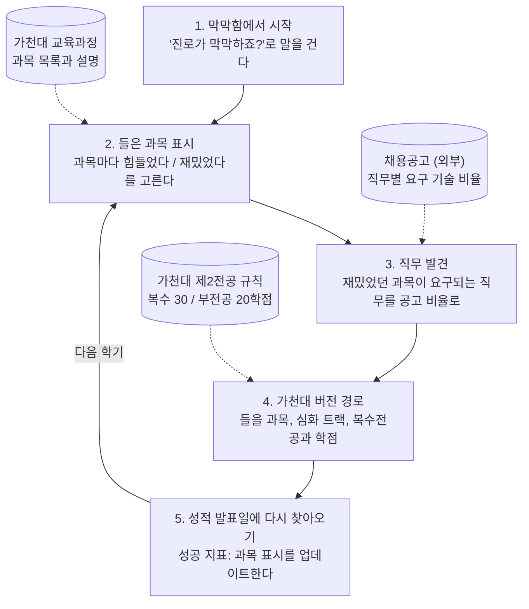

# 꿈길 진로설계 기획서

2026-11-11 기준

## 1. 개요

꿈길 진로설계는 진로가 막막한 대학생이 **지금까지 들은 과목**에서 출발해, 맞는 직무를 찾고 **우리 학교에서 밟을 경로**까지 받아보는 서비스입니다. 첫 대상은 가천대학교 컴퓨터공학과 2학년입니다.

**해결하려는 문제**

- 진로 정보가 블로그, 커뮤니티, 학교 사이트에 흩어져 있고 서로 하는 말이 다릅니다.
- 학교 교육과정표와 복수전공 안내는 있지만, "그래서 나는 무엇을 들어야 하나"로 이어 주지 않습니다.
- 일반적인 진로 글은 다른 학교, 다른 상황의 이야기라서 내 얘기로 느껴지지 않습니다.

**핵심 아이디어**: 학교 정보(교육과정, 제2전공 규칙)와 외부 정보(채용공고)를 학생의 과목 경험 위에 겹쳐서, 막막함을 다음 학기 행동으로 바꿉니다.

## 2. 타깃 사용자와 핵심 장면

첫 사용자는 **어떤 진로를 가야 할지 몰라 막막한 가천대 컴퓨터공학과 2학년**입니다.

> 여름방학 밤, 침대에 누워 휴대폰을 보고 있다. 1학기에 자료구조와 알고리즘을 들었는데 따라가기 벅찼다. 친구는 "백엔드 할 거라 정처기 따고 프로젝트 한다"며 방향이 분명한데, 나는 개발자가 맞는지조차 모르겠다. "컴공 진로 종류"를 검색했지만 블로그마다 하는 말이 달라 더 혼란스럽다.

| 항목 | 내용 |
| --- | --- |
| 누구 | 가천대 컴퓨터공학과 2학년 |
| 언제, 어디서 | 여름방학 밤, 침대에서 휴대폰으로 |
| 직전에 한 일 | "컴공 진로 종류" 검색, 블로그 글을 읽다 혼란 |
| 첫 5초에 원하는 것 | 나에게 맞는 진로가 무엇인지 |
| 맞다고 느끼는 계기 | 나와 같은 고민에서 출발한 사람의 경로 |

## 3. 사용자 흐름

학생은 진로를 고르지 않고, 막막한 상태에서 **들은 과목을 표시하는 것**으로 시작합니다.

예시: "자료구조: 힘들었다, 데이터베이스: 재밌었다"를 표시하면 "신입 데이터 분석가 공고의 다수가 SQL을 요구해요"가 나오고, 이어서 가천대에서 들을 과목과 통계학과 복수전공(30학점) 경로가 나옵니다. 한 학기 뒤 성적이 나오면 2단계로 돌아와 표시를 업데이트합니다.

## 4. 데이터 소스

과목과 전공 규칙은 **가천대 공식 사이트**, 직무에 필요한 역량은 **채용공고**에서 가져옵니다. 졸업생 취업 현황은 공개 자료에 직무 정보가 없어 첫 버전에서 빠집니다.

| 데이터 | 출처 | 쓰이는 단계 | 확인 상태 |
| --- | --- | --- | --- |
| 학년별 과목, 과목 설명 | [컴퓨터공학과 교육과정](https://www.gachon.ac.kr/ce/9526/subview.do) | 과목 표시, 들을 과목 | 공개됨 |
| 심화 트랙(AI, 빅데이터·클라우드, AIoT) | [학과 소개](https://www.gachon.ac.kr/cs/5893/subview.do) | 가천대 버전 경로 | 공개됨 |
| 복수전공·부전공 조건 | [2025-1학기 제2전공 신청 안내](https://www.gachon.ac.kr/bbs/kor/475/103113/artclView.do) | 부족한 역량 채우기 | 공개됨, 학기마다 변경 |
| 직무별 요구 역량 | 채용공고(원티드, 사람인 등) | 직무 발견 | 직접 수집 필요 |
| 졸업생 진로(직무 단위) | 대학일자리센터 | 후속 버전 | 공개 자료 없음, 문의 필요 |

**제2전공 규칙 요약** (2025-1학기 공지 기준)

- 신청 시기: 1학년 2학기부터 4학년 1학기까지, 휴학생도 가능
- 평점 기준: 없음 (학과별 예외 가능)
- 이수 학점: 부전공 20학점, 복수전공 30학점 (42학점에서 하향)
- 주전공과 같은 과목은 주전공 학점으로만 인정

가천대에는 컴퓨터공학과, AI·소프트웨어학부, 클라우드공학과가 따로 있으며, 첫 버전은 **컴퓨터공학과** 교육과정을 씁니다.

## 5. MVP 범위

첫 버전은 **가천대 컴퓨터공학과 1개 학과**와 **직무 3개**(백엔드, 데이터 분석, AI 엔지니어)만 다룹니다.

| 기능 | MVP | 비고 |
| --- | --- | --- |
| "진로가 막막하죠?" 시작 화면 | 포함 | 진로 선택이 아닌 막막함에서 시작 |
| 들은 과목에 힘들었다/재밌었다 표시 | 포함 | 가천대 컴공 교육과정 기준 |
| 채용공고 기반 직무 추천 | 포함 | "공고 N개 중 85%가 SQL 요구" 형태 |
| 가천대 버전 경로(과목, 심화 트랙) | 포함 | 기존 추천 엔진 재사용 |
| 복수·부전공 추천과 학점 계산 | 포함 | 30학점/20학점, 신청 가능 시기 |
| 표시한 과목 저장 | 포함 | 재방문을 위해 필수 |
| 자격증 추천 | 포함 | 현재 프로토타입 데이터 활용 |
| 선배 후기 | 제외 | 후속 버전에서 검토 |
| 다른 학과·다른 학교 | 제외 | 컴공에서 검증 후 확장 |

**현재 프로토타입과의 차이**

- 시작점: "진로를 고른다" → "막막함에서 과목 표시로 출발"
- 데이터: 가상 대학 3곳 → 가천대 실제 교육과정과 제2전공 규칙
- 직무 역량: 임의로 정한 값 → 채용공고에서 센 비율
- 유지: 역량 기반 추천 엔진(과목 적합도, 복수전공 추천, 학년별 로드맵)

## 6. 성공 지표

서비스가 통했는지는 **한 학기 뒤 성적이 나온 날, 학생이 과목 표시를 업데이트하러 다시 앱을 여는지**로 판단합니다.

다시 연다는 것은 추천된 경로가 한 학기 동안 학생의 계획으로 남아 있었다는 뜻입니다.

- **핵심 지표**: 성적 발표 주간의 재방문율 (첫 방문에서 과목을 표시한 학생 중 다시 표시를 업데이트한 비율)
- **보조 지표**: 첫 방문에서 가천대 버전 경로까지 도달한 비율
- 목표 수치는 첫 테스트 후 정합니다.

## 7. 위험과 검증 계획

가장 큰 위험은 **채용공고의 요구 역량과 가천대 과목이 실제로 연결되는지**입니다.

| 위험 | 왜 위험한가 | 검증·대응 |
| --- | --- | --- |
| 채용공고 수집 | 채용 사이트는 이용약관으로 자동 수집을 막는 경우가 많음 | 직무 3개의 신입 공고를 30개씩 직접 모아 요구 기술을 센다 |
| 과목과 공고 연결 | 공고는 "SQL", "Python" 같은 기술을 말하고, 교육과정은 과목명만 있음 | 가천대 과목 설명을 읽고 과목별 기술 태그를 직접 달아 본다 |
| 재방문 이유 부족 | 성적 발표일에 학생이 앱을 떠올릴 장치가 없음 | 성적 발표 시기 알림을 검토한다 |
| 학사 규칙 변경 | 제2전공 이수학점이 42학점에서 30학점으로 바뀐 것처럼 기준이 학기마다 바뀜 | 학기마다 교무 공지를 확인하고, 화면에 기준 학기를 표시한다 |
| 학과 편제 | 컴퓨터공학과, AI·소프트웨어학부, 클라우드공학과의 교육과정이 다름 | 첫 버전은 컴퓨터공학과로 한정하고, 검증 후 확장한다 |

## 8. 다음 단계

먼저 데이터로 연결이 되는지 확인하고, 그다음 프로토타입을 고칩니다.

- [x] 첫 버전의 대상 학과를 정한다 → 컴퓨터공학과
- [ ] 컴퓨터공학과의 학년별 교육과정과 과목 설명을 정리한다
- [ ] 백엔드, 데이터 분석, AI 엔지니어 신입 공고를 각 30개씩 모아 요구 기술을 센다
- [ ] 과목별 기술 태그를 달고, 공고 요구 기술과 몇 개나 이어지는지 확인한다
- [ ] 대학일자리센터에 컴공 졸업생의 직무 단위 자료가 있는지 문의한다
- [ ] 프로토타입을 "막막함 → 과목 표시 → 직무 발견 → 가천대 버전 경로" 흐름으로 고친다
- [ ] 컴공 2학년 5명에게 보여주고, 경로 화면까지 도달하는지 확인한다

## 부록: 인터뷰 결정 기록

| 질문 | 결정 |
| --- | --- |
| Q1. 누가, 어떤 상황에서 여나 | 컴공 2학년, 여름방학 밤 침대에서 |
| Q2. 첫 5초에 알고 싶은 것 | 나에게 맞는 진로가 무엇인지 |
| Q3. 맞다고 느끼는 계기 | 나와 비슷했던 사람의 실제 경로 |
| Q4. 경로 데이터 출처 | 공개 정보 (이후 학교 정보 + 채용공고로 수정) |
| Q5. "비슷하다"의 기준 | 학교는 달라도 같은 출발점의 고민 |
| Q6. 고민을 알려주는 방법 | 힘들었던 과목, 재밌었던 과목 표시 |
| Q7. 다음 행동 | 그 경로를 우리 학교 과목으로 바꿔 보기 |
| Q8. 성공 장면 | 성적이 나온 날 다시 앱을 연다 |
| 수정 | 시작점은 "어떤 진로를 가야 할지 몰라 막막하다" |
| Q9. 학교 정보 | 교육과정표, 복수·부전공 안내, 졸업생 취업 현황 |
| Q10. 직무 정보가 없을 때 | 채용 정보는 외부 정보 허용 |
| Q11. 외부 정보 종류 | 채용공고 |
| Q12. 첫 버전 대상 학과 | 컴퓨터공학과 |

### 출처

- [가천대 컴퓨터공학과 교육과정](https://www.gachon.ac.kr/ce/9526/subview.do)
- [가천대 컴퓨터공학과 학과소개](https://www.gachon.ac.kr/cs/5893/subview.do)
- [가천대 2025-1학기 제2전공 신청 안내](https://www.gachon.ac.kr/bbs/kor/475/103113/artclView.do)
- [가천대 2024-2학기 제2전공 신청 안내](https://www.gachon.ac.kr/bbs/kor/475/97891/artclView.do)
- [에듀진: 2023년 컴퓨터공학과 대학별 취업률](https://www.edujin.co.kr/news/articleView.html?idxno=47298)
- [한경 잡앤조이: 가천대 대학일자리센터 학과별 가이드북](https://magazine.hankyung.com/job-joy/article/201912275996b)
